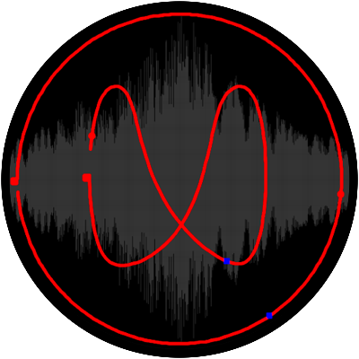

==================================
Granular sound synthesis interface
==================================

SoundGrain is a graphical interface where users can draw 
and edit trajectories to control granular sound synthesis 
modules. 

Official web site
-----------------

For source code and releases, visit
`SoundGrain on GitHub <https://github.com/belangeo/soundgrain>`_.

Requirements
------------

* Install `Python <https://www.python.org/downloads/>`_ (3.11 or higher)

The programming language used to code the application.

Install with pip
----------------

Install Soundgrain from PyPI using the command for your operating system.
Replace ``3.14`` with the Python version installed on your system.

Windows::

    py -3.14 -m pip install -U soundgrain

Linux/macOS::

    python3.14 -m pip install -U soundgrain

Then run it::

    soundgrain

Desktop registration
--------------------

After installation, register SoundGrain in the current user's application menu::

    soundgrain-register-desktop

On Linux this creates ``~/.local/share/applications/soundgrain.desktop``. On
Windows it creates a Start menu shortcut using PowerShell and launches without
a console window. On macOS it creates ``~/Applications/SoundGrain.app`` using
the built-in ``osacompile`` and ``codesign`` tools. The macOS applet is locally
signed, not Developer ID signed or notarized; it refuses to overwrite a
standalone application at the same path.

The launcher uses the Python environment from which registration was run. If
that environment is moved or removed, reinstall SoundGrain and run the
registration command again.

Run from source
---------------

Install dependencies
++++++++++++++++++++

* Install `Git <https://git-scm.com/downloads>`_

The tool needed to clone Soundgrain source code (or you can just download a zip of the sources).

* Install dependencies (pyo, wxPython and markdown)

Windows::

    py -3 -m pip install -U --user pyo wxPython markdown

Linux/macOS::

    python3 -m pip install -U --user pyo wxPython markdown

Launch the application
++++++++++++++++++++++

Open a terminal (a Command Prompt on Windows), go to the `soundgrain` folder, and launch the application.

Windows::

    cd path\to\soundgrain
    py -3 Soundgrain.py

Linux/macOS::

    cd path/to/soundgrain
    python3 Soundgrain.py
